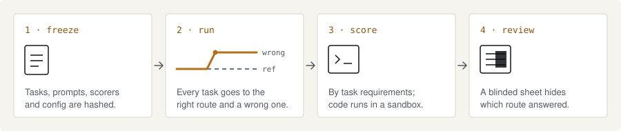

<p>
  <picture>
    <source media="(prefers-color-scheme: dark)" srcset="docs/brand/wordmark-dark.svg">
    
  </picture>
</p>

**Test the route, not just the answer.**

Farex is an open-source tool for testing AI task routing. It runs every task through the right specialist and a wrong
one, scores each answer against the task's own requirements and gives you a blinded sheet for human review.

<picture>
  <source media="(prefers-color-scheme: dark)" srcset="docs/brand/how-it-works-dark.svg">
  
</picture>

> **Early.** One local model via Ollama, four specialist system prompts, a Python CLI. Scope is same-model, prompt-only
> routing; results do not generalize to multi-model or tool-using agents. Multi-model routing is on the roadmap, not in
> the tool.

Status (2026-11-07):
- `generic_v1` (16 tasks): frozen and run once (`S2-20261102T234204Z-8661d0`, 32 of 32 cells returned). The blinded
  review sheet was marked by an AI model, not a person. Results are not published yet.
- `generic_v2` (40 tasks, all four routes for each task, plus an LLM router): frozen 2026-11-06 and run once
  (`S3-20261107T201440Z-6f13fd`, 200 of 200 cells and 40 of 40 router calls returned). Its review sheet was also marked
  by an AI model. Results are not published yet.

## Method (short)
- Each task runs under the correct specialist prompt (reference) and under wrong ones, in fresh single-turn conversations.
  `generic_v1` uses one fixed wrong route per type. `generic_v2` uses all three, plus a route chosen by a router.
- Scoring is rule-based and depends only on the task. Ambiguous or unparseable responses are `review_needed`, not wrong.
- Model-written code runs only in a Docker container with the controls verified by `--verify-sandbox`.
- Inputs are frozen and hashed. A run refuses to start if anything changed.

## Docs
| Page | Covers |
|---|---|
| [Quickstart](docs/quickstart.md) | Validate, test, set up the sandbox, try a dry run |
| [Concepts](docs/concepts.md) | Routes, cells, conditions, and what stays separate |
| [Task format](docs/tasks.md) | Fields by task type and how to write a task |
| [Scoring](docs/scoring.md) | The rules per type and their limits |
| [Sandbox](docs/sandbox.md) | Controls, verification and limits |
| [Freeze and run](docs/freeze.md) | What a freeze covers and what a run checks |
| [Stage 3 runbook](docs/stage3-run.md) | The guarded `generic_v2` run, from preflight to shutdown |
| [Blinded review](docs/review.md) | Sheets, marks, the join and a second reviewer |
| [Design notes](docs/design.md) | Goals, scope, method decisions, limits and roadmap |
| [Output files](docs/outputs.md) | Row schema, statuses and the manifest |
| [Troubleshooting](docs/troubleshooting.md) | Refusal messages and what to do next |

## Setup (reproducible)
Requirements: macOS on Apple silicon, Python 3.14, Homebrew.
```
brew install colima docker docker-buildx
colima start --vm-type vz --cpu 2 --memory 4 --disk 20
docker pull --platform linux/arm64 python:3.14-slim        # then pin by digest, see farex_pilot/sandbox.py PINNED_IMAGE
```
The sandbox image is pinned by digest in `farex_pilot/sandbox.py`. It never pulls automatically (`--pull never`).

## Commands (no model calls)
```
python3 -m farex_pilot.runner --validate              # generic_v1 task data and prompt mapping
python3 -m farex_pilot.stage3 --validate              # generic_v2 task data, router prompt, order
python3 -I -m unittest discover -s tests -v           # scorer, pipeline, sandbox and docs tests
python3 -m farex_pilot.runner --verify-sandbox        # runs container probes; records artifacts/sandbox_verification/
python3 -m farex_pilot.stage3 --dry-run               # canned answers, labelled DRY RUN, no model; coding cells use the sandbox
python3 -m farex_pilot.stage3 --status FILE.jsonl     # blinded: completion and problems only
python3 tools/publish_check.py                        # what git would publish: machine paths, secrets, files needing a decision
```
Real runs (`--run`) are guarded. Before any model call they check approval, the freeze (files, config, order file), the
model name and full digest, the live local Ollama digest (metadata only), no sandbox-image override, and a fresh sandbox
verification of the backend that scores coding cells. Any mismatch refuses the run. See [Freeze and run](docs/freeze.md).

## Limitations (read before interpreting anything)
- Scorer rules are conservative and are written and tested against fixtures we wrote.
  Coverage of fixtures does not establish general scorer validity. Human review checks the scorer on the outputs it reads.
- The sandbox probes test the controls they cover. They do not show that arbitrary code is safe.
- The Colima VM shares the host home directory into the VM by default. The container itself is tested not to see it.
- Container output is collected through bounded readers (64 KiB per stream); exceeding it kills the container.
- Coding verdicts are computed on the host from returned values; expected outputs never enter the container. The
  candidate still controls the values it returns (that is what is scored).
- Token counts come from the provider only; `chars/4` estimates are not used.

Historical code and data: [farex-ai/research](https://github.com/farex-ai/research). Its clinical results have known scoring problems and are not used here.

## License
MIT. See `LICENSE`.
